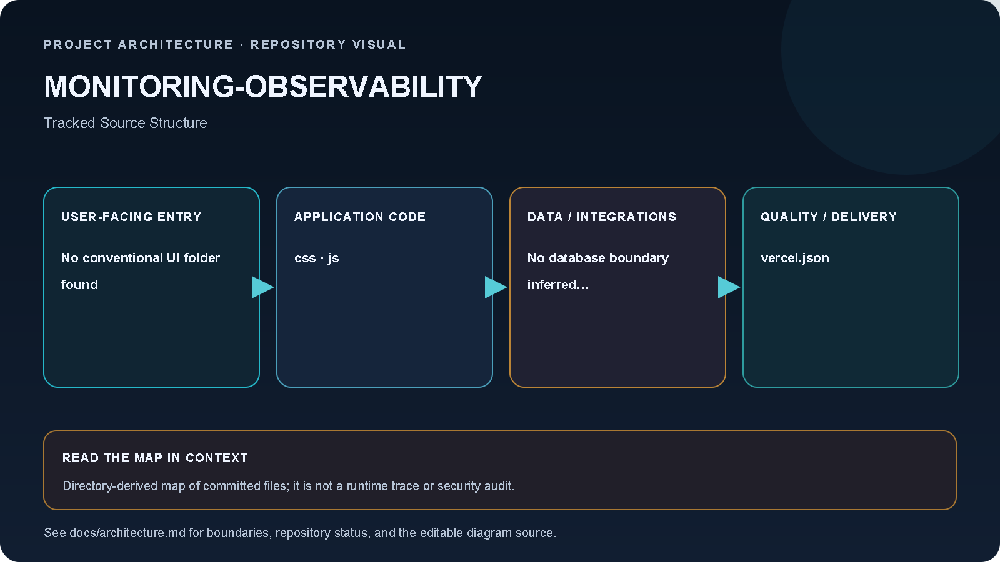
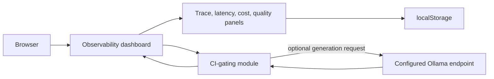

# SLM Observability Lab

<strong>A browser dashboard prototype for exploring traces, latency, cost estimates, quality checks, and CI-style gates for local language-model workflows.</strong>

**Live link:** [https://monitoring-observability.vercel.app/](https://monitoring-observability.vercel.app/)

HTML · CSS · JavaScript · Browser local storage · Ollama API

## Project overview

The app is a static, client-side observability workbench. Its panels organize trace, latency, cost, quality, and CI-gating interactions. The browser stores the dashboard state locally; the CI-gating flow can send a generation request to the Ollama URL configured in the page.

## Included views

- Trace and request inspection
- Latency measurements and cost estimates
- Quality review controls
- CI-gating workflow for a local Ollama endpoint
- Browser-persisted dashboard state

## Architecture

[Architecture notes](docs/architecture.md) · [Editable SVG](docs/images/monitoring-observability-architecture.svg)

## Run locally

Open `index.html` in a browser, or serve the repository with any static web server. For the CI-gating interaction, run Ollama locally and set the endpoint in the dashboard. Browser cross-origin rules may require configuring Ollama to allow the page origin.

## Important scope note

This repository does not include a telemetry collector, hosted database, or production monitoring backend. The interface is a local demonstration; values entered or generated in the page should not be treated as a live service-wide monitoring feed.

## Project structure

- `index.html` — dashboard page
- `css/` — styles
- `js/` — trace, latency, cost, quality, and CI-gating interactions
- `slm_ragas_flowchart.svg` — included workflow diagram
- `vercel.json` — static-site deployment configuration
